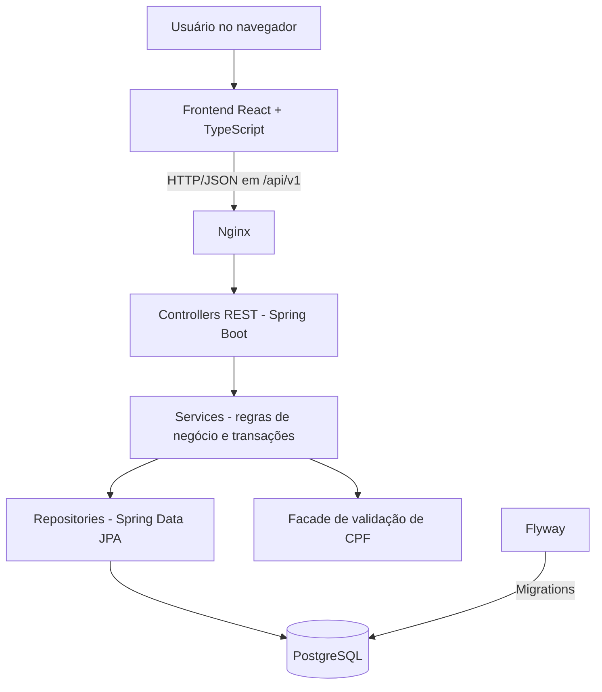

# Sistema de Votação Cooperativa

Aplicação full stack desenvolvida para gerenciar pautas e sessões de votação de
uma cooperativa. O sistema permite cadastrar associados e pautas, abrir uma
sessão por tempo determinado, registrar votos `SIM` ou `NAO` e consultar o
resultado da votação.

## Funcionalidades

- cadastro e consulta de pautas;
- abertura de uma sessão de votação, com duração informada ou padrão de
  1 minuto;
- cadastro e consulta paginada de associados;
- validação estrutural do CPF e simulação da autorização do associado para
  votar;
- registro de votos `SIM` ou `NAO`;
- bloqueio de mais de um voto do mesmo associado na mesma sessão;
- encerramento automático da sessão ao atingir o horário final;
- consulta da quantidade de votos e do resultado da pauta;
- interface web responsiva para executar todo o fluxo;
- documentação interativa da API com Swagger;
- migrations do banco de dados com Flyway;
- testes automatizados e testes de performance com k6.

## Tecnologias

| Área           | Tecnologias                                                                 |
| -------------- | --------------------------------------------------------------------------- |
| Backend        | Java 21, Spring Boot 4.1, Spring Web MVC, Spring Data JPA e Bean Validation |
| Banco de dados | PostgreSQL 16 e Flyway                                                      |
| Frontend       | React 19, TypeScript, Vite e Material UI                                    |
| Testes         | JUnit 5, MockMvc e Testcontainers                                           |
| Performance    | k6                                                                          |
| Infraestrutura | Docker, Docker Compose e Nginx                                              |
| Documentação   | OpenAPI e Swagger UI                                                        |

## Estrutura do projeto

```text
.
├── backend/       API REST, regras de negócio, migrations e testes
├── frontend/      aplicação React
├── performance/   massa, scripts e resultados dos testes com k6
└── docker-compose.yaml
```

## Arquitetura

A solução utiliza uma arquitetura cliente-servidor. O backend é um monólito
modular organizado em camadas, enquanto o frontend é uma aplicação React
independente que consome a API REST por HTTP/JSON.



No ambiente Docker, o Nginx serve os arquivos estáticos gerados pelo Vite e
encaminha as requisições iniciadas em `/api/` para o container do backend. O
Spring Boot processa a requisição, aplica as regras de negócio e acessa o
PostgreSQL por meio do Spring Data JPA. O Docker Compose cria a rede interna,
inicia os três serviços e aguarda o banco ficar saudável antes de iniciar a
API.

### Camadas do backend

| Camada         | Responsabilidade                                                             |
| -------------- | ---------------------------------------------------------------------------- |
| `controller`   | Expõe os endpoints REST, valida os dados de entrada e define os códigos HTTP |
| `dto`          | Define os contratos de entrada e saída sem expor as entidades JPA            |
| `service`      | Concentra regras de negócio, casos de uso e limites transacionais            |
| `facade`       | Isola a integração simulada que determina se o CPF está apto a votar         |
| `repository`   | Executa o acesso ao PostgreSQL com Spring Data JPA e consultas agregadas     |
| `domain`       | Representa as entidades e os enums do domínio de votação                     |
| `exception`    | Centraliza as exceções da aplicação e padroniza as respostas de erro         |
| `db/migration` | Versiona a estrutura, as restrições e os índices do banco com Flyway         |

O fluxo de uma requisição segue, em geral:

1. o frontend chama um endpoint em `/api/v1`;
2. o controller valida a requisição e delega o caso de uso;
3. o service aplica as regras de negócio dentro de uma transação;
4. o repository consulta ou persiste os dados;
5. o resultado é convertido em DTO e devolvido ao frontend;
6. quando uma regra falha, o `GlobalExceptionHandler` transforma a exceção em
   uma resposta HTTP padronizada.

### Organização do frontend

O frontend também separa responsabilidades: `pages` organiza as telas,
`components` concentra os componentes visuais, `services` encapsula as chamadas
HTTP com Axios, `types` define os contratos TypeScript e `utils` reúne
validações auxiliares. Essa separação evita que componentes de interface
conheçam detalhes de comunicação com a API.

## Como executar

### Pré-requisitos

- Docker Desktop;
- Docker Compose.

Não é necessário instalar Java, Maven, Node.js ou PostgreSQL para executar a
aplicação completa pelo Docker.

### Subindo a aplicação

Na raiz do projeto, execute:

```bash
docker compose up --build
```

Após a inicialização, os serviços estarão disponíveis em:

| Serviço               | Endereço                                      |
| --------------------- | --------------------------------------------- |
| Aplicação web         | <http://localhost:5173>                       |
| Swagger UI            | <http://localhost:8080/swagger-ui/index.html> |
| Especificação OpenAPI | <http://localhost:8080/v3/api-docs>           |
| API REST              | <http://localhost:8080/api/v1>                |
| PostgreSQL            | `localhost:5433`                              |

Para conferir o estado dos containers:

```bash
docker compose ps
```

Os containers `voting_pg`, `voting_backend` e `voting_frontend` devem aparecer
como ativos. O banco também deve apresentar o estado `healthy`.

Para encerrar a aplicação sem apagar os dados:

```bash
docker compose down
```

O PostgreSQL utiliza o volume `postgres-data`, portanto os dados permanecem
disponíveis entre as execuções. Para remover também o banco e recriar o ambiente
do zero, use:

```bash
docker compose down -v
```

> Atenção: a opção `-v` apaga todos os dados armazenados no volume.

## Fluxo de uso

Pela aplicação web:

1. acesse a área **Associados** e cadastre um CPF válido;
2. acesse **Pautas** e cadastre o assunto que será votado;
3. abra uma sessão para a pauta, informando a duração desejada;
4. enquanto a sessão estiver aberta, selecione um associado e registre o voto;
5. acompanhe a contagem e o resultado na própria pauta.

A integração de validação do CPF é simulada, conforme a proposta do desafio.
Depois da validação dos dígitos, o serviço retorna aleatoriamente se o associado
está apto ou não a votar.

## Endpoints principais

Todos os endpoints estão versionados com o prefixo `/api/v1`.

| Método   | Endpoint                     | Descrição                          |
| -------- | ---------------------------- | ---------------------------------- |
| `POST`   | `/associados`                | Cadastra um associado              |
| `GET`    | `/associados?page=0&size=10` | Lista associados de forma paginada |
| `GET`    | `/associados/{id}`           | Consulta um associado              |
| `POST`   | `/pautas`                    | Cadastra uma pauta                 |
| `GET`    | `/pautas?page=0&size=10`     | Lista as pautas de forma paginada  |
| `GET`    | `/pautas/{id}`               | Consulta uma pauta                 |
| `POST`   | `/sessoes/{pautaId}`         | Abre a sessão de uma pauta         |
| `GET`    | `/sessoes/{pautaId}`         | Consulta a sessão da pauta         |
| `DELETE` | `/sessoes/{pautaId}`         | Exclui a sessão da pauta           |
| `POST`   | `/votos/{pautaId}`           | Registra um voto                   |
| `GET`    | `/resultados/{pautaId}`      | Consulta o resultado da votação    |

Os contratos completos, exemplos de requisição e possíveis códigos HTTP podem
ser consultados no Swagger UI.

### Exemplo do fluxo pela API

Cadastrar um associado:

```http
POST /api/v1/associados
Content-Type: application/json

{
  "cpf": "52998224725"
}
```

Cadastrar uma pauta:

```http
POST /api/v1/pautas
Content-Type: application/json

{
  "titulo": "Aprovação do orçamento anual",
  "descricao": "Votação do orçamento da cooperativa para o próximo ano"
}
```

Abrir uma sessão usando a duração padrão:

```http
POST /api/v1/sessoes/1
```

Registrar um voto:

```http
POST /api/v1/votos/1
Content-Type: application/json

{
  "associadoId": 1,
  "opcao": "SIM"
}
```

Consultar o resultado:

```http
GET /api/v1/resultados/1
```

## Regras de negócio

- cada pauta pode possuir apenas uma sessão de votação;
- quando a duração não é informada, a sessão permanece aberta por 1 minuto;
- somente sessões abertas aceitam votos;
- cada associado pode votar apenas uma vez por sessão;
- o CPF deve possuir 11 dígitos e passar pela validação dos dígitos
  verificadores;
- a autorização para votar é simulada e pode retornar `ABLE_TO_VOTE` ou
  `UNABLE_TO_VOTE`;
- o resultado pode ser `EM_ANDAMENTO`, `APROVADA`, `REPROVADA`, `EMPATE` ou
  `SEM_VOTOS`.

A unicidade do voto é protegida também no PostgreSQL pela restrição
`(sessao_id, associado_id)`. Dessa forma, a regra continua válida mesmo com
requisições concorrentes.

## Testes automatizados

Os testes do backend incluem regras de serviço, controllers, validação simulada
de CPF e integrações com PostgreSQL real por meio de Testcontainers.

Para executá-los localmente, mantenha o Docker ativo e use:

```bash
cd backend
mvn test
```

Para validar o frontend:

```bash
cd frontend
npm ci
npm run build
npm run lint
```

## Performance

Foi avaliada a consulta:

```http
GET /api/v1/resultados/{pautaId}
```

O cenário utiliza uma sessão com **5 milhões de votos**, aquecimento de
30 segundos, 10 usuários virtuais, carga de 10 minutos e três execuções por
configuração. Os números abaixo representam a mediana das três execuções.

| Métrica     | Sem índice | Com índice |       Melhora |
| ----------- | ---------: | ---------: | ------------: |
| Média       |   3.136 ms |   1.528 ms |   51,3% menor |
| p50         |   3.038 ms |   1.243 ms |   59,1% menor |
| p95         |   4.957 ms |   2.779 ms |   43,9% menor |
| p99         |   5.824 ms |   3.167 ms |   45,6% menor |
| Throughput  | 3,01 req/s | 6,18 req/s |  105,3% maior |
| Falhas HTTP |         0% |         0% | sem regressão |

O índice composto utilizado foi:

```sql
CREATE INDEX idx_votos_sessao_opcao
    ON votos (sessao_id, opcao);
```

Com ele, a latência média caiu aproximadamente pela metade e o throughput mais
que dobrou, mantendo 0% de falhas HTTP. A massa, os scripts, os resultados
brutos e o procedimento de reprodução estão em
[`performance/`](performance/README.md).

## Decisões técnicas

- **Flyway:** mantém o esquema versionado e reproduzível.
- **Restrição de unicidade no banco:** protege contra votos duplicados inclusive
  em cenários concorrentes.
- **Consulta agregada:** contabiliza `SIM` e `NAO` diretamente no PostgreSQL,
  sem carregar os votos em memória.
- **Índice composto:** atende o filtro e o agrupamento usados na consulta do
  resultado.
- **DTOs e validação:** evitam expor entidades JPA e rejeitam requisições
  inválidas antes da regra de negócio.
- **Tratamento global de erros:** padroniza as respostas HTTP da API.
- **API versionada:** concentra as rotas sob `/api/v1`.
- **Docker Compose:** inicia banco, backend e frontend com um único comando.
