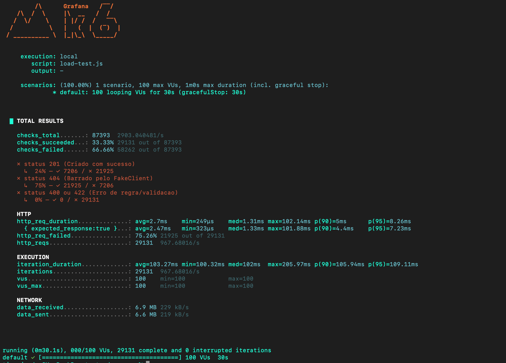

# Teste de Carga

## Performance e teste de estresse

A API foi validada em cenário de alta concorrência para comprovar não apenas throughput, mas também consistência de regra de negócio sob estresse.

Na infraestrutura, foram aplicadas duas otimizações principais:

- Indexação estratégica na tabela de votos para reduzir custo de busca e contabilização.
- Ajuste do pool de conexões HikariCP para absorver picos de escrita sem contenção excessiva de threads.

No teste com k6 (100 VUs por 30 segundos, alvo em POST /votos), o sistema sustentou alta vazão com baixa latência e sem erro 500.

Métricas observadas:

- Vazão total: 28.387 votos em 30s (aprox. 944 req/s).
- Latência média: 5,22 ms.
- Latência p95: 12,35 ms.

### Motivo técnico dos bloqueios (404)

O bloqueio de parte das requisições foi esperado e desejado. Ele não indica falha de performance, e sim cumprimento da regra de elegibilidade no FakeCpfValidationClient.

A validação externa simula:

- 50% de CPFs inexistentes.
- 25% de CPFs inelegíveis para voto.

Com isso, a taxa esperada de sucesso é de 25%, e a taxa esperada de bloqueio é de 75%.

- Sucesso esperado: 25% (status 201 Created).
- Bloqueio esperado: 75% (status 404 Not Found).

Conclusão: sob carga, a aplicação manteve integridade funcional e previsibilidade estatística, sem race conditions perceptíveis entre validação externa e persistência.

Este diretório contém um script de teste de carga com k6 para simular votos no endpoint da API.

## Arquivo

- `load-test.js`: envia requisições `POST` para `http://localhost:8080/api/v1/votos`.

## Pré-requisitos

- API rodando localmente em `http://localhost:8080`
- k6 instalado

No macOS (Homebrew):

```bash
brew install k6
```

## Como executar

Antes de rodar, edite o arquivo `load-test.js` e defina manualmente o campo `sessaoVotacaoId` com o ID de uma sessao de votacao valida no seu ambiente.

No diretório `teste-de-carga`:

```bash
k6 run load-test.js
```

## Configuração atual do script

- `vus`: 100 usuários virtuais
- `duration`: 30s
- `sessaoVotacaoId`: definido diretamente no script
- `vote`: alterna aleatoriamente entre `SIM` e `NAO`

## Observações

- O script gera CPFs aleatórios a cada requisição.
- As respostas esperadas no check incluem status `201`, `404`, `400` e `422`.
- Para testar outro ambiente, ajuste a variável `url` no script.


